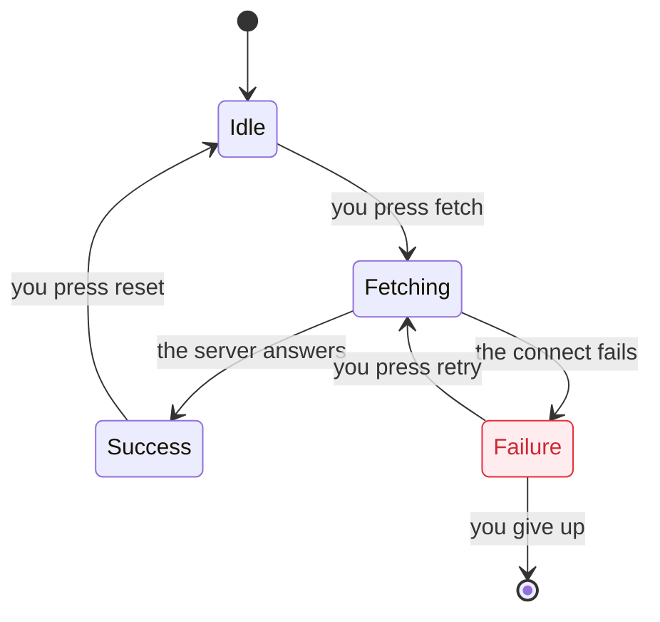

Show how a system moves between states, in the words of the user. Write the chart as a Mermaid
`stateDiagram-v2`, render it to a PNG, and show the PNG to the user.

## Requirements

- `bun` on `PATH`.
- `bun install` in the hellstack repository. It installs `pele` and `@resvg/resvg-js`. A render
  takes less than 1 second.

## Workflow

1. Write the chart to a `.mmd` file in a scratch folder outside the repo, for example
   `/tmp/statechart/<topic>.mmd`. See "Write the chart" below.
2. Render it:

   ```bash
   bun <skill-dir>/scripts/statechart.ts /tmp/statechart/<topic>.mmd
   ```

   The script writes `<topic>.png` next to the `.mmd` file, and writes its path to stdout. Use
   `--light` for the light theme. Use `bun <skill-dir>/scripts/statechart.ts --help` for all the
   options.

3. **Look at the PNG.** Read the image and check it. Can you read all the labels? Is each arrow
   clear? Does the chart answer the question of the user? Change the `.mmd` file and render it again
   until the chart is good.
4. Show the chart to the user. See "Show the chart" below.
5. In your reply, put the Mermaid text in a `mermaid` code block and the path of the PNG. Add one
   short line for each thing that the user must know, such as a state that breaks a rule. Keep the
   prose short.

If Pele cannot parse the chart, the script prints the error and the line, and exits with status 1.

## Write the chart

- Label each state with what the user can see or cares about, such as `Paying` or
  `Lease held, write pending`. Do not use variable names or code names as labels.
- Label each arrow with the event as the user sees it happen, such as `you press play` or
  `the connect fails`. When the step can occur only in some conditions, add the condition in
  brackets: `you press play [while the file loads]`.
- Use `[*]` for the start and the end states.
- Aim for 20 arrows or fewer. Give one label to states that act the same. Leave out steps that the
  user does not need, and say in your reply which steps you left out.
- Use `state Parent { ... }` for parent states, and `--` in a parent state for parallel regions.
- Use `note right of State : text` for a short fact about a state.
- Leave out `direction`. The script picks the layout that fits the terminal.

Color the states with classes. Give each phase of the flow one group color, and mark the states that
are wrong:



| Class                                                       | Use it for                                        |
| ----------------------------------------------------------- | ------------------------------------------------- |
| `blue`, `teal`, `purple`, `orange`, `yellow`, `tan`, `pink` | The phase of a state. One color for each phase.   |
| `breaks`                                                    | A state that breaks a rule. Red border and text.  |
| `mayBreak`                                                  | A state that can break a rule. Orange border.     |
| `bugPath`                                                   | A state on the path to a bug. Blue border.        |
| `repeats`                                                   | A state in a loop that never ends. Purple border. |

The script sets the colors of these classes for the theme. Add a `classDef` line only for `breaks`
and `mayBreak`, so that other Mermaid viewers also show the marks. Pele does not color parent
states.

## Show the chart

In a Rex terminal (`REX_SESSION` is set), show the image in a pane next to yours. The script fits
the image to the pane. First close the pane of the last chart, so that only one chart pane is open:

```bash
old=$(rex block ls -s "$REX_SESSION" --json | jq -r '.blocks[] | select(.label == "statechart") | .block_id')
[ -n "$old" ] && rex block close $old
block=$(rex run -s "$REX_SESSION" --split=right --focus=false -c /tmp/statechart \
  -- sh -c 'bun <skill-dir>/scripts/statechart.ts <topic>.mmd --show; read _')
rex block rename "$block" statechart
```

Leave the pane open, so that the user can look at the chart. The user closes it, or the next chart
replaces it.

In other terminals, open the PNG with `open <topic>.png`.
